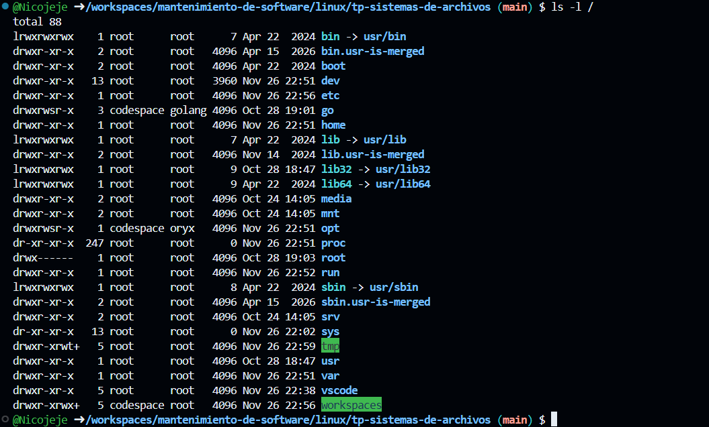
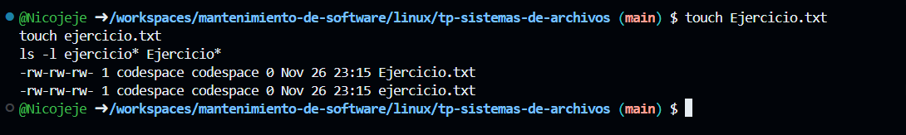
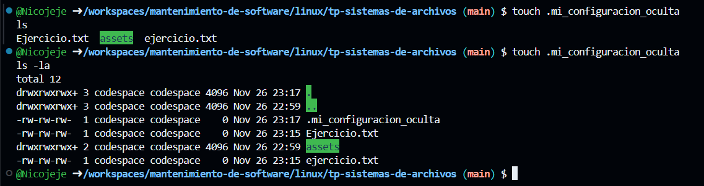
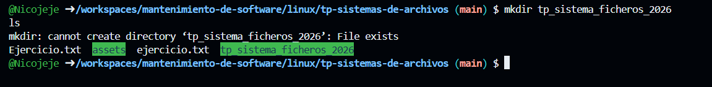
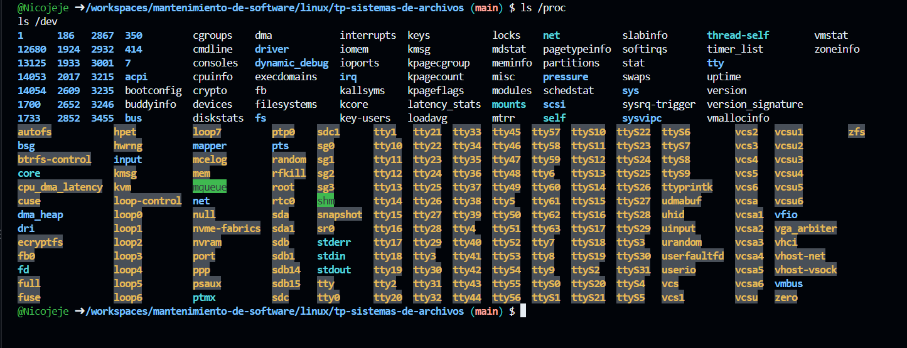

# TP: Sistema de Archivos en Linux

* **Materia:** Mantenimiento de Software
* **Estudiante:** Nombre y Apellido
* **Fecha de Entrega:** 2026
* **Profesor:** Nombre del Profesor

---

## 1. Estructura del Árbol de Directorios

Comando ejecutado:

```bash
ls -l /
```



| Directorio | Función según la guía |
| :--- | :--- |
| `/etc` | Archivos de configuración de la mayoría de los programas. |
| `/home` | Archivos personales de los usuarios. |
| `/dev` | Archivos simbólicos que representan hardware. |
| `/var` | Datos variables como registros (logs) y bases de datos. |

---

## 2. Sensibilidad a Mayúsculas y Minúsculas

Comandos ejecutados:

```bash
touch Ejercicio.txt
touch ejercicio.txt
ls -l ejercicio* Ejercicio*
```



**Respuesta:** En Linux es posible tener `Ejercicio.txt` y `ejercicio.txt` en la misma carpeta porque el sistema de archivos distingue entre mayúsculas y minúsculas (*case sensitive*): para Linux, una `E` y una `e` son caracteres distintos, por lo tanto los dos nombres son archivos diferentes. En Windows, en cambio, el sistema de archivos (NTFS) preserva las mayúsculas al guardar el nombre pero no las distingue al compararlo (*case insensitive*), así que `Ejercicio.txt` y `ejercicio.txt` se consideran el mismo nombre y no pueden coexistir en una misma carpeta.

---

## 3. Visualización y Gestión de Archivos Ocultos

Comandos ejecutados:

```bash
touch .mi_configuracion_oculta
ls
ls -la
```



**Utilidad de los archivos ocultos:** En Linux, los archivos y directorios cuyo nombre empieza con un punto (`.`) no se muestran con un `ls` común; solo aparecen con `ls -a` o `ls -la`. Se usan principalmente para guardar configuraciones personales de programas y del entorno de cada usuario (por ejemplo `.bashrc`, `.profile`, `.ssh`, `.gitconfig`). Ocultarlos mantiene limpio el directorio de trabajo, evita que el usuario los modifique o los borre por accidente y separa los datos de configuración de los archivos de uso diario.

---

## 4. Buenas Prácticas en Nombres de Archivos

Comando ejecutado:

```bash
mkdir tp_sistema_ficheros_2026
```



**Justificación:** El nombre `tp_sistema_ficheros_2026` cumple con las recomendaciones de la guía porque:

* Está escrito completamente en minúsculas.
* No tiene espacios (se usan guiones bajos `_` para separar palabras).
* No contiene acentos, la letra "ñ" ni caracteres especiales.
* Solo usa letras, números y guiones bajos, por lo que se puede escribir y usar en la terminal sin comillas ni caracteres de escape.

En cambio, `TP Sistema de Ficheros (Año 2026)!.doc` no las cumple porque:

* Tiene espacios, que obligan a usar comillas o escapes en la terminal y pueden romper scripts.
* Mezcla mayúsculas y minúsculas, lo que genera confusión por la sensibilidad a mayúsculas de Linux.
* Incluye la "ñ" (en "Año"), que puede causar problemas de codificación entre sistemas.
* Contiene paréntesis y un signo de exclamación `!`, caracteres que tienen significado especial para el *shell*.

---

## 5. Exploración de Dispositivos y Procesos

Comandos ejecutados:

```bash
ls /proc
ls /dev
```



**Información que almacena `/proc`:** `/proc` es un sistema de archivos virtual (no está guardado en el disco, lo genera el kernel en memoria) que expone información del sistema y de los procesos en ejecución. Contiene un directorio numérico por cada proceso activo, nombrado con su PID (con datos como su línea de comando, memoria usada y archivos abiertos), además de archivos con información del sistema como `cpuinfo` (procesador), `meminfo` (memoria), `uptime` (tiempo encendido) y `version` (versión del kernel). Por su parte, `/dev` contiene archivos que representan los dispositivos de hardware (discos, terminales, etc.), de modo que Linux los trata como si fueran archivos.
