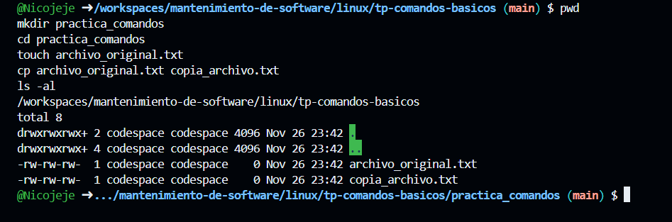
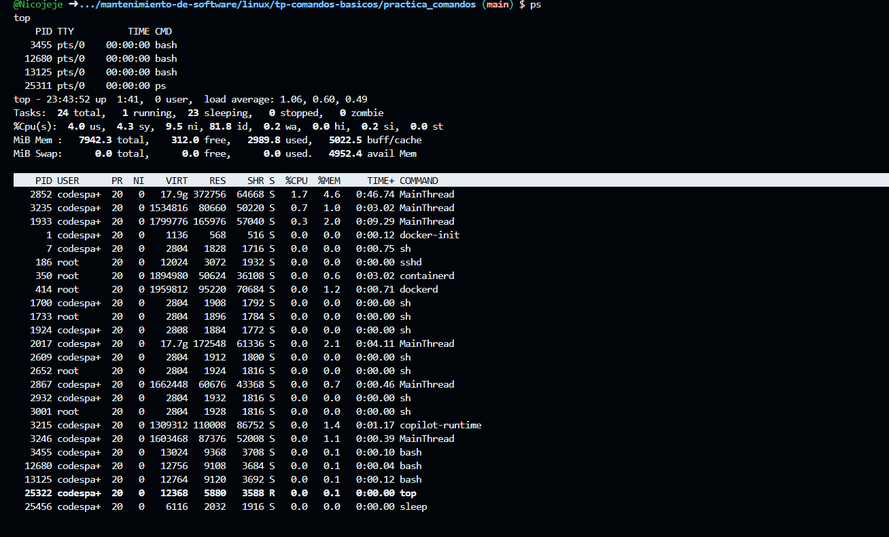
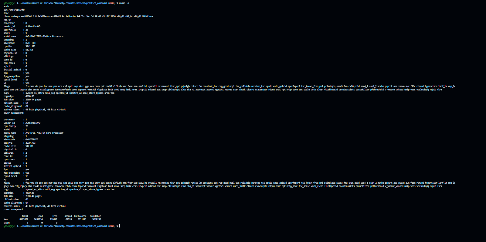
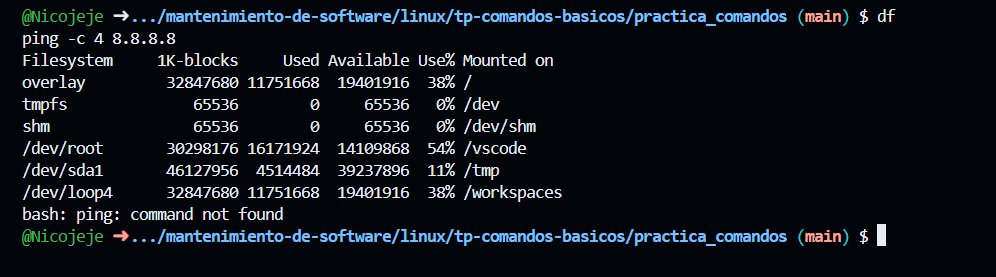

# TP: Comandos Básicos, Procesos y Utilidades en Linux

* **Materia:** Mantenimiento de Software
* **Estudiante:** Aldo Nicolás Cañizarez
* **Fecha de Entrega:** 2026
* **Profesor:** Gabriel Artaza

---

## 1. Gestión de Archivos y Directorios

Comandos ejecutados:

```bash
pwd
mkdir practica_comandos
cd practica_comandos
touch archivo_original.txt
cp archivo_original.txt copia_archivo.txt
ls -al
```



* **Explicación de `ls -al`:** El comando `ls` simple muestra solamente los nombres de los archivos y directorios visibles de la carpeta actual, sin detalles y sin mostrar los ocultos (los que empiezan con punto). En cambio, `ls -al` combina dos opciones: `-a` (*all*) incluye también los archivos y directorios ocultos, incluidos `.` (el directorio actual) y `..` (el directorio padre), y `-l` (*long*) muestra el listado en formato largo, con los permisos, la cantidad de enlaces, el usuario y grupo propietarios, el tamaño en bytes, la fecha de última modificación y el nombre de cada elemento.

---

## 2. Monitoreo de Procesos

Comandos ejecutados:

```bash
ps
top
```



* **Diferencia entre `ps` y `top`:** El comando `ps` (sin opciones) muestra una "foto" estática de los procesos de la terminal actual en un instante determinado y termina inmediatamente: solo lista unos pocos datos (PID, terminal, tiempo de CPU y nombre del comando). Por su parte, `top` es una herramienta interactiva que se actualiza continuamente en tiempo real y muestra todos los procesos del sistema junto con el uso de CPU y memoria de cada uno, la carga del sistema y el tiempo encendido, ordenados normalmente por consumo de recursos. Se mantiene en ejecución hasta que el usuario sale presionando la tecla `q`.
* **Uso de `kill`:** El comando `kill <pid>` se usa para finalizar un proceso indicando su número de identificación (PID). Cuando un programa se cuelga o deja de responder, se busca su PID con `ps` o `top` y se ejecuta `kill` para enviarle una señal de terminación (por defecto, `SIGTERM`, que le pide al programa que se cierre ordenadamente). Si el programa sigue sin responder, se puede forzar su cierre con `kill -9 <pid>` (`SIGKILL`).

---

## 3. Información del Sistema

Comandos ejecutados:

```bash
uname -a
arch
cat /proc/cpuinfo
free
```



* **Detalles del Kernel y Memoria:**
  * **`uname -a`:** Muestra toda la información disponible sobre el núcleo (kernel) y el sistema: el nombre del kernel (Linux), el nombre del equipo (hostname), la versión y release del kernel, la fecha de compilación, la arquitectura del hardware (por ejemplo `x86_64`) y el sistema operativo.
  * **`arch`:** Indica la arquitectura del procesador de la máquina (por ejemplo `x86_64`).
  * **`cat /proc/cpuinfo`:** Muestra los datos del procesador: modelo, fabricante, velocidad, cantidad de núcleos y características.
  * **`free`:** Muestra el estado de la memoria del sistema: la memoria RAM total, usada, libre, compartida, en búfer/caché y disponible, y también el espacio de intercambio (*swap*). Los valores se expresan en kilobytes por defecto.

---

## 4. Red y Espacio en Disco

Comandos ejecutados:

```bash
df
ping -c 4 8.8.8.8
```



* **Espacio en disco (`df`):** Muestra, para cada sistema de archivos montado, su tamaño total, el espacio usado, el disponible, el porcentaje de uso y el punto de montaje. Sirve para detectar a tiempo discos llenos antes de que provoquen fallas.
* **Funcionamiento de `ping`:** El objetivo principal de `ping` es verificar la conectividad entre dos equipos en una red TCP/IP y medir el tiempo de respuesta. Funciona enviando paquetes ICMP de tipo *echo request* al equipo de destino (en este caso `8.8.8.8`, un servidor DNS público de Google) y esperando su respuesta *echo reply*. Si llegan las respuestas, hay conexión y se puede ver la latencia (tiempo de ida y vuelta) y si se perdieron paquetes. La opción `-c 4` limita el envío a 4 paquetes.
