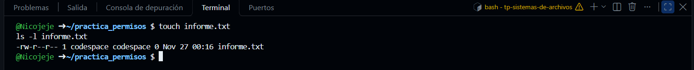
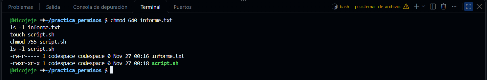
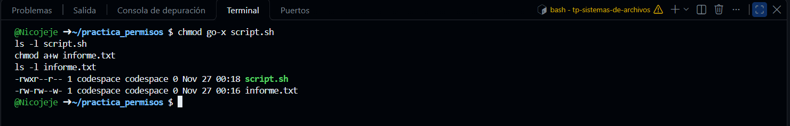
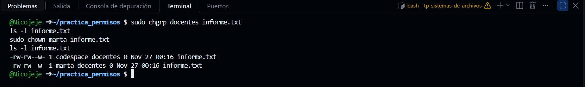
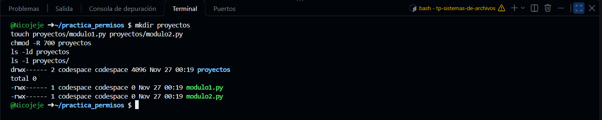

# TP: Permisos de Archivos, Directorios y Propiedad en Linux

* **Materia:** Mantenimiento de Software
* **Estudiante:** Aldo Nicolás Cañizarez
* **Fecha de Entrega:** 2026
* **Profesor:** Gabriel Artaza

---

## 1. Lectura e Interpretación de Permisos (`ls -l`)

Comandos ejecutados:

```bash
touch informe.txt
ls -l informe.txt
```



La salida de `ls -l` comienza con una cadena de 10 caracteres, por ejemplo `-rw-r--r--`. El primer carácter indica el **tipo de elemento** y los 9 restantes se dividen en tres grupos de tres, que corresponden a los permisos del propietario, del grupo y de los demás usuarios.

| Posición | Representación | Significado / Permiso |
| :--- | :--- | :--- |
| Tipo | `-` / `d` / `l` | `-` es un archivo regular, `d` es un directorio y `l` es un enlace simbólico (*link*). |
| Propietario (`u`) | `rwx` | Permisos del usuario dueño del archivo (caracteres 2 a 4). |
| Grupo (`g`) | `rwx` | Permisos de los usuarios que pertenecen al grupo del archivo (caracteres 5 a 7). |
| Otros (`o`) | `rwx` | Permisos de todos los demás usuarios del sistema (caracteres 8 a 10). |

Significado de cada letra (en cada uno de los tres niveles):

* **`r` (read, lectura):** en un archivo permite ver su contenido; en un directorio permite listar los nombres de lo que contiene.
* **`w` (write, escritura):** en un archivo permite modificarlo; en un directorio permite crear, renombrar y borrar elementos dentro de él.
* **`x` (execute, ejecución):** en un archivo permite ejecutarlo como programa o script; en un directorio permite entrar en él y acceder a su contenido.
* **`-`:** indica que ese permiso no está concedido.

---

## 2. Permisos en Modo Octal

Comandos ejecutados:

```bash
chmod 640 informe.txt
ls -l informe.txt
touch script.sh
chmod 755 script.sh
ls -l script.sh
```



En el modo octal cada permiso tiene un valor: lectura `r` = 4, escritura `w` = 2 y ejecución `x` = 1. Se suman los valores de los permisos concedidos en cada nivel (propietario, grupo, otros) y cada suma da un dígito.

* **Desglose numérico `640`:**

  | Nivel | Permisos | Cálculo | Dígito |
  | :--- | :--- | :--- | :---: |
  | Propietario | `rw-` | r(4) + w(2) = 6 | **6** |
  | Grupo | `r--` | r(4) = 4 | **4** |
  | Otros | `---` | sin permisos = 0 | **0** |

  Resultado: `640` equivale a `rw-r-----`.

* **Desglose numérico `755`:**

  | Nivel | Permisos | Cálculo | Dígito |
  | :--- | :--- | :--- | :---: |
  | Propietario | `rwx` | r(4) + w(2) + x(1) = 7 | **7** |
  | Grupo | `r-x` | r(4) + x(1) = 5 | **5** |
  | Otros | `r-x` | r(4) + x(1) = 5 | **5** |

  Resultado: `755` equivale a `rwxr-xr-x`.

---

## 3. Modo Simbólico

Comandos ejecutados:

```bash
chmod go-x script.sh
ls -l script.sh
chmod a+w informe.txt
ls -l informe.txt
```



* **Ventaja del modo simbólico:** Permite agregar (`+`) o quitar (`-`) un permiso puntual sin tener que conocer ni reescribir los permisos que el archivo ya tiene: los demás permisos quedan intactos. Con el modo octal, en cambio, hay que indicar siempre los tres dígitos completos, así que para cambiar un solo permiso se debe calcular de nuevo todo el conjunto, con el riesgo de sobrescribir permisos existentes por error. Por ejemplo, `chmod go-x script.sh` solo quita la ejecución al grupo y a otros, y `chmod a+w informe.txt` solo suma la escritura para todos.

---

## 4. Cambio de Propietario y Grupo

Comandos ejecutados:

```bash
sudo chgrp docentes informe.txt
ls -l informe.txt
sudo chown marta informe.txt
ls -l informe.txt
```



* **¿Por qué se requiere privilegio superusuario para `chown`?:** Porque cambiar el propietario de un archivo es una operación restringida al usuario root, y un usuario común no puede "regalar" ni transferir sus archivos a otro. Esto se hace por seguridad: evita que alguien pueda hacer pasar archivos propios por archivos de otro usuario, eludir cuotas de disco cargándole archivos a otra cuenta o dejar archivos peligrosos a nombre de terceros. Por eso el comando debe ejecutarse con `sudo` o como root.

---

## 5. Permisos Recursivos en Directorios

Comandos ejecutados:

```bash
mkdir proyectos
touch proyectos/modulo1.py proyectos/modulo2.py
chmod -R 700 proyectos
ls -ld proyectos
ls -l proyectos/
```



* **Importancia del permiso `x` en un directorio:** En un directorio, el permiso de ejecución (`x`) no significa "ejecutar" sino **permiso de acceso o travesía**: permite entrar en el directorio (por ejemplo con `cd`) y acceder a los archivos y subdirectorios que contiene, siempre que se conozca su nombre. Si a un directorio se le quita el permiso `x`, el usuario ya no puede entrar en él ni abrir, leer o modificar su contenido, aunque tenga permiso de lectura (`r`) sobre los archivos de adentro; como mucho, con `r` podría ver los nombres de los elementos, pero no sus detalles. Por eso los directorios normalmente llevan `x` (por ejemplo `755` o `700`) y, en este caso, `chmod -R 700 proyectos` deja el directorio y su contenido accesibles únicamente para el propietario.
