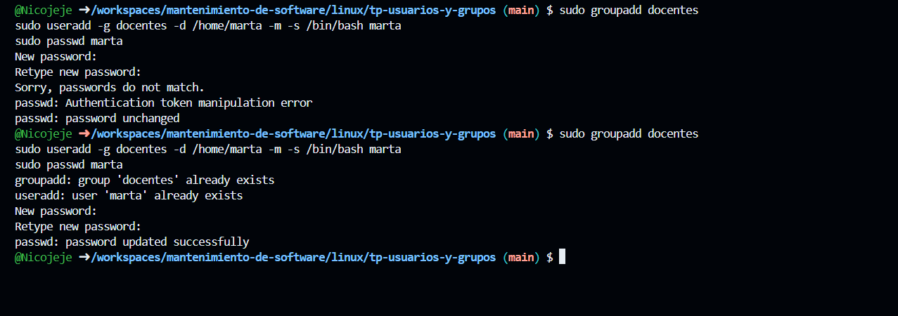
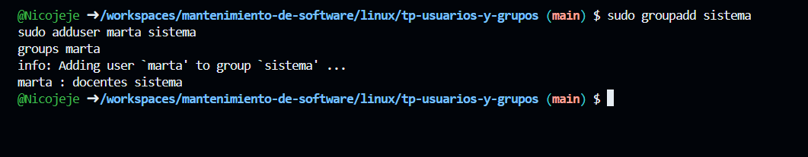
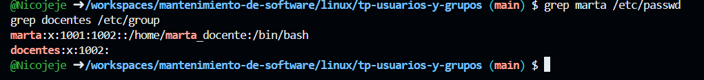
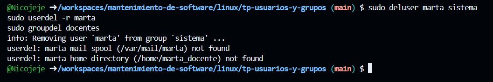

# TP: Administración de Usuarios y Grupos en Linux

* **Materia:** Mantenimiento de Software
* **Estudiante:** Aldo Nicolás Cañizarez
* **Fecha de Entrega:** 2026
* **Profesor:** Gabriel Artaza

---

## 1. Creación de Grupos y Usuarios

Comandos ejecutados:

```bash
sudo groupadd docentes
sudo useradd -g docentes -d /home/marta -m -s /bin/bash marta
sudo passwd marta
```



* **Explicación del parámetro `-m`:** La opción `-m` (*create home*) le indica a `useradd` que cree automáticamente el directorio personal del usuario (en este caso `/home/marta`) y que copie en él los archivos de configuración iniciales desde `/etc/skel`. Si se omite, la cuenta se crea igualmente y el directorio `/home/marta` queda registrado en `/etc/passwd`, pero la carpeta no existe físicamente en el disco. Entonces el usuario no tendría un lugar donde guardar sus archivos personales y su configuración, y podría tener problemas al iniciar sesión (por ejemplo, entrar con `/` como directorio de trabajo).

---

## 2. Gestión de Grupos Secundarios

Comandos ejecutados:

```bash
sudo groupadd sistema
sudo adduser marta sistema
groups marta
```



* **Comando para quitar usuario de un grupo:** Para quitar a un usuario de un grupo secundario se utiliza `sudo deluser <usuario> <grupo>`, por ejemplo `sudo deluser marta sistema`. Esto elimina la pertenencia al grupo, pero no borra al usuario ni al grupo.

---

## 3. Modificación de Usuarios

Comando ejecutado:

```bash
sudo usermod -d /home/marta_docente marta
```


* **Diferencia entre `useradd` y `usermod`:** `useradd` sirve para **crear** una cuenta de usuario nueva, que todavía no existe en el sistema. En cambio, `usermod` sirve para **modificar** los parámetros de una cuenta que ya existe (por ejemplo su directorio personal, su shell, su grupo principal o sus grupos secundarios). Cabe aclarar que `usermod -d` solo cambia la ruta registrada del directorio personal; para mover también el contenido de la carpeta existente hay que agregar la opción `-m`.

---

## 4. Ficheros de Configuración

Comandos ejecutados:

```bash
grep marta /etc/passwd
grep docentes /etc/group
```



| Fichero | Contenido / Función |
| :--- | :--- |
| `/etc/passwd` | Guarda la información de las cuentas de usuario del sistema, una línea por usuario, con campos separados por `:` (nombre de usuario, marca de contraseña, UID, GID del grupo principal, comentario, directorio personal y shell). Puede ser leído por todos los usuarios. |
| `/etc/group` | Guarda la información de los grupos del sistema: nombre del grupo, marca de contraseña, GID y la lista de usuarios que pertenecen al grupo como miembros secundarios. |
| `/etc/shadow` | Guarda las contraseñas de los usuarios en forma cifrada (hash), junto con datos de caducidad y vigencia de la contraseña. Solo puede ser leído por el usuario root (o con `sudo`), por seguridad. |

---

## 5. Eliminación de Usuarios y Grupos

Comandos ejecutados:

```bash
sudo deluser marta sistema
sudo userdel -r marta
sudo groupdel docentes
```



* **Uso del parámetro `-r` en `userdel`:** La opción `-r` (*remove*) hace que, además de borrar la cuenta del usuario, se elimine su directorio personal y todo su contenido, así como su buzón de correo. Sin esta opción, la cuenta se borra pero los archivos del usuario quedan en el disco.
* **Condición para borrar un grupo con `groupdel`:** Para poder eliminar un grupo, este no debe ser el grupo primario de ningún usuario existente. Por eso primero se elimina al usuario `marta` (cuyo grupo principal era `docentes`) y recién después se puede borrar el grupo. Si algún usuario todavía lo tiene como grupo principal, `groupdel` rechaza la operación con un error.
